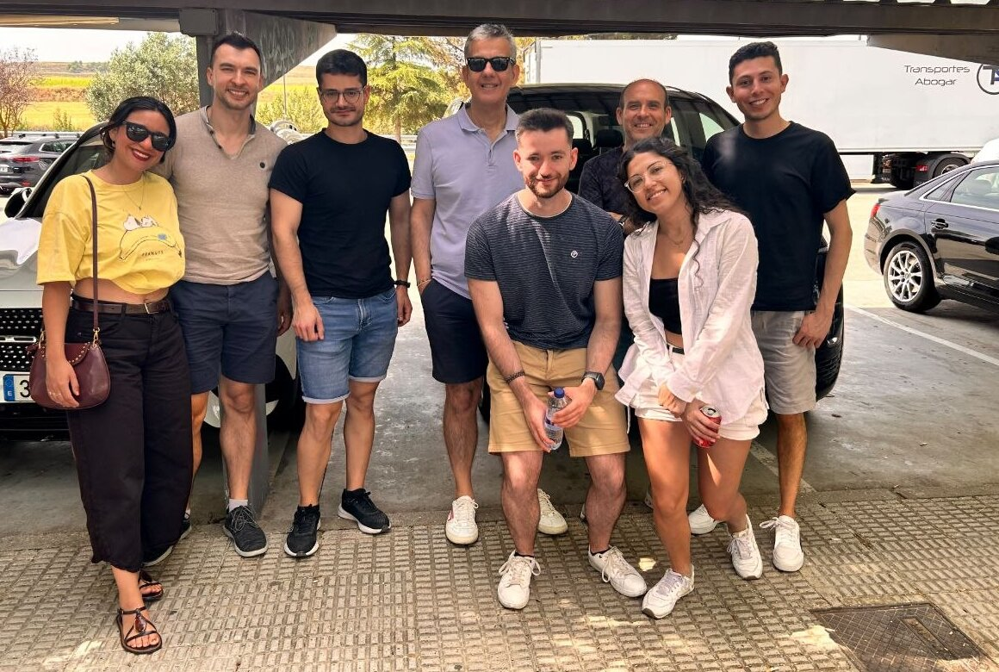

Together with our colleagues from [TunonLab](https://www.tunonlab.com/), we
made a road trip to Salamanca for the 14th Electronic Structure, Principles
and Applications conference (ESPA2026), held from 30 June to 3 July together
with the biennial meeting of the Chemistry and Computation group of the
Spanish Royal Society of Chemistry.

Kirill gave the talk *Unexpected advantage of physical models in hybrid
Machine Learning / Molecular Mechanics simulations*. He showed that the EMLE
scheme, trained only on gas-phase data, goes beyond mimicking QM/MM: it
predicts Raman spectra, avoids the charge spill-out problem of QM/MM, and
enables enhanced sampling methods that are impossible with standard QM/MM or
naïve ML/MM potentials.

Rubén presented the poster *Accelerating convergence of ML/MM simulations with
mean field approach*. Because EMLE separates the gas-phase energy of the ML
region from its interaction with the environment, the expensive ML energy can
be computed once while the MM environment relaxes around it. The averaged MM
forces then act as a mean field on the reactive region, giving free energy
profiles at a fraction of the cost of conventional ML/MM simulations.
